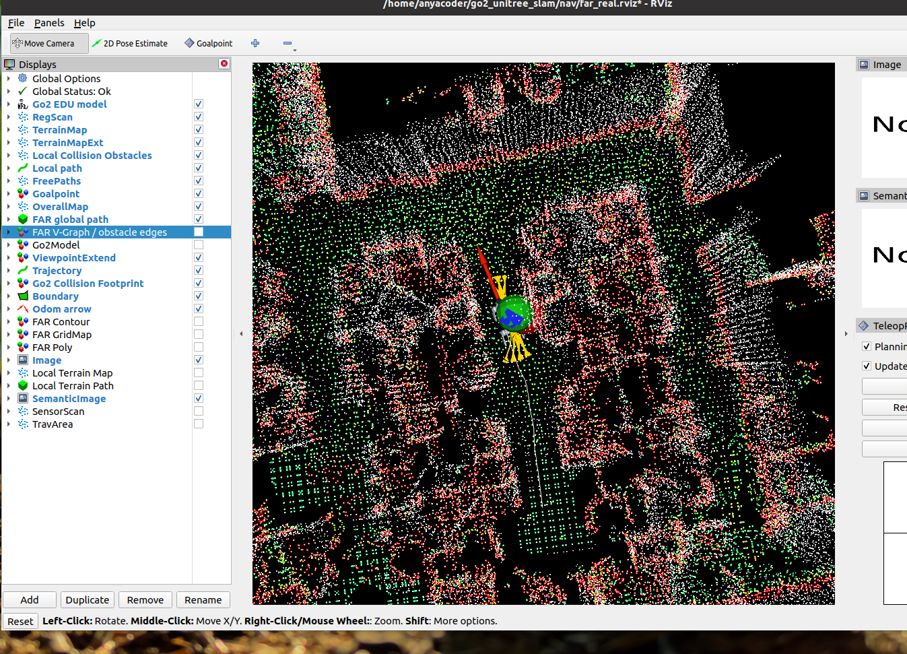
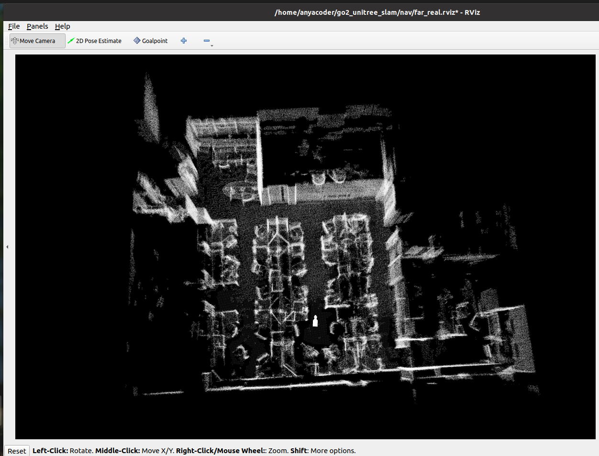

# 必看：电脑本地地图 + 真机状态上行 / Waypoint 独立下行架构

> 每次继续导航、FAR、RViz 或真机接入工作前，先完整读完本文。
> 最近更新：2026-10-21
> 本文描述的是唯一允许的运行架构；旧方案、临时方案和相反的描述全部作废。

## 0. 一句话架构

**全局规划只在电脑端：电脑只加载固定静态 PCD，并由 pcdMapSim 跟随真机重定位 odom 生成滚动虚拟扫描来运行 FAR。不使用人工可走区，不生成 `/sim/free_space` 或 `/sim/free_boundary`。电脑 FAR 的最终目标和当前 `/way_point` 经独立下行通道送到狗端；狗端不启动 FAR，只运行 localPlanner/pathFollower 做局部避障、路径生成和执行。狗端上行重定位 odom、TF、关节状态；RViz 初始位姿使用另一条独立命令通道。实时最小障碍云当前默认关闭。**

算法基准是上游原版，不是本项目自研：

- FAR planner 来自 `MichaelFYang/far_planner`，通过
  `jizhang-cmu/autonomy_stack_go2` 集成。
- `terrainAnalysis`、`terrainAnalysisExt`、`localPlanner`、`pathFollower`
  来自 `jizhang-cmu/autonomy_stack_go2` 原版。
- 本仓库的 `nav/`、`nav_dog/` 只负责固定地图、网络隔离、状态/命令传输、
  初始位姿、启动编排和可视化，不替代上游规划算法。

## 0.0 唯一启动链（强制）

### 0.0.1 一键启动（首选）

电脑端只需要运行：

```bash
cd ~/go2_unitree_slam
./nav/start_far_real.sh
```

该脚本会先清理旧栈，再依次同步狗端导航文件、启动狗端 `UnitreeSlam`、狗端
`go2_nav`（含 Goalpoint 安全闸），最后启动电脑端固定地图/FAR/RViz。它会自动再次执行
`nav_dog/disable_legacy_control.sh`，确保 UnitreeSlam 旧运动控制节点不会出现。

一键全部停止：

```bash
cd ~/go2_unitree_slam
./nav/stop_real_all.sh
```

停止范围只包括本项目 SLAM/导航/FAR/RViz/桥接进程。Unitree 底层服务和物理遥控器
接管链路不在清理范围内。

下面的三终端拆分仅用于排障和查看各自日志；正常使用以 `start_far_real.sh` 为唯一入口：

```text
狗端终端 A：UnitreeSlam 常驻、雷达与 LIO/重定位
  cd /unitree/module/graph_pid_ws
  ./0_unitree_slam.sh

狗端终端 B：狗端局部规划与底盘执行
  cd /home/unitree/go2_nav
  ./run_nav.sh live

电脑端终端 C：状态桥、固定地图、FAR、RViz
  cd ~/go2_unitree_slam
  ./nav/run_real_view.sh
```

启动顺序是硬约束：先让狗站稳并完全静止约 3 秒，等待 IMU 校准通过；再在 RViz
使用一次 `2D Pose Estimate`。初始化桥会启动 `command=6` 重定位，并在
`lio_sam_ros2_globalLocalize` 输出 `Map Optimization Started` 后提交 `/initialpose`。
只有看到狗端 `Pose initialization successful` / `Initializing Succeed` 后，才允许点
FAR Goalpoint。

唯一链路边界：

- `0_unitree_slam.sh` 负责启动 `QT_Server/UnitreeSlam`；雷达、LIO 和重定位由该常驻服务在收到重定位命令后拉起。
- `run_nav.sh live` 负责狗端 `terrainAnalysis`、`terrainAnalysisExt`、`localPlanner`、`pathFollower`，以及 `nav_safety_gate.py`。`pathFollower` 的输出被强制重映射到 `/nav/path_follower_request`，只有安全闸能发布 `/api/sport/request`。
- `run_real_view.sh` 负责狗端状态/waypoint/初始位姿三座桥，以及电脑端固定 PCD、FAR 和 RViz。
- 禁止再手工启动 `demo_mid360`、`run_demo.sh`、第二套 `navigation_without_nav2_qt_test.launch.py`、重复的 Livox/LIO、狗端 FAR、第二个 `go2_nav.launch.py` 或第二个 RViz。
- 日常重启必须同时重启三端，不要在旧节点未清理时叠加启动。
- 禁止把 `sport_out` 改回 `/api/sport/request`，也禁止绕过安全闸直接给 `pathFollower` 接入底盘话题。

### 0.0.2 Goalpoint 硬安全闸（强制）

原版 `localPlanner` 的目标初值是 `(0,0)`，原版 `pathFollower` 又会保留旧
`/path`。因此仅靠“这次还没点目标”不能证明底盘没有控制请求。当前集成层增加
`nav_dog/nav_safety_gate.py`，形成唯一可执行链：

```text
Go2 /path
  -> pathFollower
  -> /nav/path_follower_request
  -> nav_safety_gate（硬门控）
  -> /api/sport/request
```

安全闸启动即关闭。只有以下条件全部成立，`Move(api_id=1008)` 才会放行：

```text
1. /livox/imu 连续静止采样通过校准健康检查
   - 采样窗口约 2.5 s，至少 100 帧，无大间隔
   - 三轴 gyro bias 每轴不超过 0.03 rad/s
   - 三轴 gyro std 最大不超过 0.02 rad/s
   - accel 模长在 9.00 ~ 10.60 m/s^2
2. 当前定位 epoch 收到新的 /initialpose
3. 当前 epoch 之后出现 Pose initialization successful / Initializing Succeed
4. 重定位 odom 持续新鲜（1 s 内）、位姿数值有限；首次锁定定位时，odom 距所选初值不超过 5 m、yaw 差不超过 1.0 rad
5. 当前 epoch 收到新的 FAR /goal_point
6. 当前 epoch 收到 FAR /way_point
7. localPlanner 在新 goal 之后生成新的非空 /path，且 /path 在 3 s 内刷新
```

第 4 项的距离/yaw 只用于首次取得定位锚点，锁定后不会因为狗正常走远而反复撤销。
第 5、6 项在同一个 goal 内不会按时间过期；新 Goalpoint 才会清空旧 waypoint/path。
IMU/odom 超时或 localPlanner path 超过 3 s 未刷新时，立即撤销运动许可。若
`pathFollower` 仍在发 `Move`，安全闸会用 `StopMove(api_id=1003)` 替换。安全闸只
放行 `StopMove` 和 `Move`，其余 Sport API 编号全部丢弃。重新点一次
`2D Pose Estimate` 会开启新的定位 epoch，并清空旧 goal、waypoint 和 path，必须
重新点 Goalpoint。

查看实时门控状态：

```bash
ssh go2-wifi
source /opt/ros/foxy/setup.bash
source /home/unitree/autonomy_stack_go2/install/setup.bash
timeout 3 ros2 topic echo /nav/safety_status std_msgs/msg/String \
  --qos-reliability reliable --qos-durability transient_local
```

`goal_commands_ready=true` 才表示 IMU、初始位姿和定位均已就绪，此时可以点
Goalpoint；`motion_ready=true` 才表示当前 goal 已有 waypoint，且 localPlanner path 仍在刷新。
`/nav/goal_commands_ready=false` 时，狗端 waypoint 桥会直接丢弃 Goalpoint 和
`/way_point`，不会把它们灌给 localPlanner。

### 0.0.1 FAR 真机链禁止 UnitreeSlam 控制“小三”（强制）

只要使用 FAR 点选导航，狗端运动控制权只能属于：

```text
电脑 FAR -> TCP 8899 -> 狗端 localPlanner -> 狗端 pathFollower
```

禁止同时出现 UnitreeSlam 重定位流程附带的旧运动控制节点：

```text
dog_control_B1_one / ROS 节点 /dog_control
go2_control_by_sdk send_cmd
```

注意：`navigation_without_nav2_qt_test.launch.py` 本身必须保留，因为它还负责启动
LIO-SAM、`IniPoseFromText` 和重定位相关节点。禁止的是该 launch 内部的
`dog_control_B1_one` 节点以及额外的 `go2_control_by_sdk send_cmd`。

当前冲突来源已经确认：UnitreeSlam 的重定位脚本：

```text
/unitree/module/graph_pid_ws/src/QT_Server/shell/re_location.sh
```

会无条件启动：

```text
ros2 run send_cmd high_rate_state
ros2 run go2_control_by_sdk send_cmd
ros2 launch task navigation_without_nav2_qt_test.launch.py
```

而原始 `navigation_without_nav2_qt_test.launch.py` 会启动
`dog_control_B1_one`。该旧控制节点会订阅 `/cmd_vel`、`/dog_movement`、
`/node_control` 等控制输入，可能在操作员从未指定 FAR 目标时仍影响狗的运动或
恢复旧控制状态。因此“FAR 没点目标”不等于“底盘没有控制源”。

现已通过 `nav_dog/disable_legacy_control.sh` 做了 FAR-only 处理：

```text
re_location.sh 不再启动 go2_control_by_sdk send_cmd
src/task/launch 与 install/task/share/task/launch 两份 launch 都保留 LIO，
但都不再启动 dog_control_B1_one
```

必须同时修改 `src` 和 `install/share`；`ros2 launch task ...` 实际读取的是 install/share。
UnitreeSlam 更新或重装后应重新执行：

```bash
cd ~/go2_unitree_slam
./nav_dog/disable_legacy_control.sh
```

FAR 真机验收前，狗端下面两条检查必须为空：

```bash
pgrep -af '[d]og_control_B1_one'
pgrep -af '[g]o2_control_by_sdk.*send_cmd'
```

同时 ROS 节点 `/dog_control` 必须不存在。

任何一条有输出，结论都是：

```text
FAR 控制权不唯一，禁止让狗进入运动模式。
```

`nav/check_real_chain.sh` 必须把上述任一进程判为 `FAIL`。禁止用实时里程计或局部规划结果
掩盖这个冲突；必须先消除第二套控制链，再测试 FAR。

```text
Go2 -> 电脑（状态/感知上行，TCP 8898）
  /lio_sam_ros2/mapping/re_location_odometry
  /tf
  /tf_static
  /joint_states
  最小动态障碍云：默认关闭，仅可通过 FAR_VIZ_CLOUD_ENABLE=1 临时启用

电脑 -> Go2（waypoint 下行，独立端口/独立开关）
  操作员最终目标 /goal_point
  FAR 当前导航点 /way_point

电脑 -> Go2（RViz 初始位姿，独立端口/独立开关）
  RViz 2D Pose Estimate -> /initialpose -> TCP 8900 -> 狗端 /qt_command + /initialpose

电脑本地（ROS domain 97，回环网卡）
  固定完整静态 PCD（唯一地图输入）
  -> pcd_map_sim（跟随真机 odom 生成虚拟扫描）
  -> /registered_scan
  -> terrain_analysis -> FAR/localPlanner/RViz -> Go2 模型与本地地图显示
  -> FAR /way_point -> TCP 8899 -> Go2 localPlanner
  -> Go2 /path -> pathFollower
  -> /nav/path_follower_request -> nav_safety_gate -> /api/sport/request
```

## 0.1 狗端点云预处理（强制）

狗端 local terrain 必须使用 MID360 的实时扫描，但送入 terrainAnalysis 前必须先完成坐标转换和自身回波过滤：

```text
/lio_sam_ros2/mapping/cloud_registered [上游实际为 odom]
  -> go2_cloud_frame_self_filter
       1. 查询最新 map <- odom TF
       2. 把点云转换到 map
       3. 删除重定位位姿周围 0.70 m、垂直 ±0.65 m 内的狗体回波
  -> /nav/cloud_registered_map [map]
  -> terrainAnalysis / terrainAnalysisExt
  -> localPlanner
```

强制规则：

- 不得把 `cloud_registered` 原样直接送给 terrainAnalysis。它的 header 和点坐标属于 `odom`，而 terrainAnalysis 不做 TF 转换。
- TF 尚未建立或查询失败时，过滤节点必须停止发布点云；不得把未转换的原始点云作为回退发出。
- `terrainAnalysis`、`terrainAnalysisExt`、`localPlanner` 的 `/registered_scan` 必须统一重映射到 `/nav/cloud_registered_map`。
- 自身回波过滤是传感器预处理，不修改 FAR、localPlanner、pathFollower 或底盘控制算法。
- 静态 PCD 不能替代狗端实时 terrain；静态 PCD 只供电脑 FAR 做全局规划。

## 1. 数据归属，不允许混淆

| 数据 | 唯一来源 | 说明 |
|---|---|---|
| 重定位位姿 | 狗端 `re_location_odometry` | 决定狗在本地地图上的位置 |
| 动态 TF | 狗端 `/tf` | 只读转发 |
| 静态 TF | 狗端 `/tf_static` | 只读转发 |
| 关节姿态 | 狗端 `/joint_states` | 驱动 Go2 模型腿部 |
| 最小动态障碍云 | 狗端上行，可选 | 默认关闭；只有显式设置 `FAR_VIZ_CLOUD_ENABLE=1` 才启用，启用时必须限频、限范围、降采样 |
| 在线地形扫描 | 电脑本地生成 | 用真机 odom 从完整静态 PCD 截取滚动窗口，不回传狗端完整点云 |
| `/registered_scan` | 电脑本地生成 | 默认直接使用静态虚拟扫描，供 terrain/FAR 在线层使用 |
| Waypoint | 电脑独立下行通道 | 电脑点选的目标点；不混入状态上行协议 |
| RViz 初始位姿 | 电脑独立下行通道 | `2D Pose Estimate` 经 TCP 8900 发到狗端 `/initialpose`；不经过 waypoint 通道 |
| 完整静态地形 | 电脑本地 `GlobalMap_clean_20261020_1920_nav_green_edited.pcd` | 不在网络上传整张点云 |
| FAR、全局静态地图和 RViz | 电脑本地 | 狗端不承担全局规划与显示 |
| localPlanner、pathFollower | 狗端 | 接收电脑 FAR waypoint，负责局部避障、路径生成和底盘执行 |

### 狗端允许上行的全部数据

```text
/lio_sam_ros2/mapping/re_location_odometry
/tf
/tf_static
/joint_states
可选：/lio_sam_ros2/mapping/lasercloud_in_world 的最小障碍子集（默认关闭）
```

最小障碍云默认不启用。若因明确需求临时启用，必须同时满足：

```text
最高 1~2 Hz
距狗只保留约 6 m 范围
体素降采样约 0.15 m
单帧上限约 12000 点
不得把地面、天花板或与静态地图不重合的表面直接注入 FAR
```

除此之外不转发：

```text
原始 MID360 / L1 点云
完整 registered_scan / terrain_map / terrain_map_ext
相机图像
FAR Marker / FAR Path / Polygon
路径数组或底盘速度长时间流
```

### Waypoint 下行通道

Waypoint 与状态上行严格分离：

```text
电脑本地 /goal_point
  -> 独立 waypoint 命令通道（建议 TCP 8899）
  -> 狗端 /goal_point
```

要求：

- 命令通道默认开启；只有 RViz 人工点选 `/goal_point` 时才会产生流量，可用 `GO2_WAYPOINT_ENABLE=0` 显式关闭。
- 只能发送点选 waypoint，不允许发送 `cmd_vel`、初始化位姿或任意底盘指令。
- 状态上行 TCP 8898 的协议不改造成任意命令通道。
- 发送端必须限频、去重，并显示目标坐标供人工确认。
- 狗端收到 waypoint 后由既定导航链路执行；本通道不直接控制电机。

### RViz 初始位姿下行通道

```text
电脑 RViz 2D Pose Estimate
  -> 电脑 /initialpose
  -> go2_initialpose_sender
  -> TCP 8900
  -> 狗端 initialpose_link
  -> /qt_command (command=6, attribute=2) 启动重定位
  -> 等待 5 秒
  -> 狗端 /initialpose
  -> lio_sam_ros2_globalLocalize
```

要求：

- 一次拖拽同时完成“启动重定位”和“提交初始位姿”，不要求狗端再按 `z`。
- 只发送地图坐标系下的 `x / y / yaw`。
- 电脑和狗端使用独立的 `nav/initialpose_sender.py`、`nav_dog/initialpose_link.py`。
- 不借用 TCP 8899 waypoint 通道。
- 点击后必须同时检查电脑 `/tmp/go2_initialpose_sender.log` 与狗端 `/tmp/initialpose_link.log` 的 `sent / received / relocation / published` 计数。

## 2. 固定输入文件

工作目录：

```text
/home/anyacoder/go2_unitree_slam
```

完整静态地图：

```text
/home/anyacoder/go2_unitree_slam/GlobalMap_clean_20261020_1920_nav_green_edited.pcd
```

未经明确要求，不换图、不重新生成、不覆盖上述固定 PCD。

## 3. 正常启动流程

### 3.1 狗端

1. 开机并确认电脑能 SSH 到 `go2-wifi`。
2. 启动 SLAM/重定位服务并保持在终端中运行。
3. 不需要在狗端按 `z`。在电脑 RViz 使用一次 `2D Pose Estimate`，初始化桥会自动发送 `command=6` 启动重定位；随后等待狗端 `lio_sam_ros2_globalLocalize` 输出 `Map Optimization Started`（首张地图加载完成），再发送拖拽出的 `/initialpose`。不要在固定 5 秒时抢发初值。
4. 重定位完成后，狗端应持续发布 `re_location_odometry`；电脑 `/state_estimation` 应持续收到有效狗位姿。

狗端不启动 FAR 或 RViz；只启动 localPlanner/pathFollower 执行电脑下发的 waypoint。狗端雷达、相机不因本显示架构额外转发。


- 重启狗端 localPlanner/pathFollower 后，最终 `/goal_point` 不会持久保存；必须在 RViz 重新点选目标，否则可能出现“`/path` 正常但 pathFollower 不执行”。

### 3.2 电脑端

在一个终端执行：

```bash
cd ~/go2_unitree_slam
./nav/run_real_view.sh
```

脚本按顺序完成：

1. 清理上一条本地显示链，不触碰狗端服务。
2. 通过 SSH 启动狗端只读关节桥、状态上行桥（TCP 8898）、waypoint 命令桥（TCP 8899）和初始位姿桥（TCP 8900）。
3. 启动电脑端接收器，发布 `/state_estimation`、`/tf`、`/tf_static`、`/joint_states`。
4. 默认不启动最小障碍云合并层；`/sim/registered_scan` 直接作为 `/registered_scan` 供 terrain/FAR 使用。
5. 启动电脑端 waypoint 发送器；默认开启，只等待 RViz 点选，不会自动发送目标。
6. 在电脑本机 `ROS_DOMAIN_ID=97`、`ROS_LOCALHOST_ONLY=0`，并绑定 `nav/cyclonedds_lo.xml` 仅用回环网卡的环境中启动 `map_sim`：
   - 本地静态 PCD
   - `terrain_analysis` / `localPlanner` / `far_planner`（全部在电脑端）
   - Go2 `robot_state_publisher`
   - RViz

本机 Foxy + CycloneDDS 在 `ROS_LOCALHOST_ONLY=1` 时会创建节点失败，因此电脑本地栈固定使用 `ROS_LOCALHOST_ONLY=0`，再通过 `CYCLONEDDS_URI=file:///home/anyacoder/go2_unitree_slam/nav/cyclonedds_lo.xml` 只绑定回环网卡，避免和狗端 DDS 混在一起。状态/障碍云走 TCP 8898；waypoint 走独立命令通道 8899；两者不可混用协议。

## 3.3 FAR 在线层语义

`pcd_map_sim` 模拟滚动激光 -> `terrain_analysis` -> `far_planner -> /viz_graph_topic`、`/viz_poly_topic`。FAR 按原版算法更新在线节点、连通性和局部边界。

`/viz_graph_topic` 中红色 `polygon_edge` 是 FAR 的 contour 图拓扑连接，不是静态墙面轮廓，也不是地图错位。它允许跨越道路中心并随在线图更新；障碍和可通行判断只来自 FAR 对固定静态 PCD 的原生在线处理。

### 3.4 真机在线层

真机模式固定使用：

```text
/state_estimation
  -> pcd_map_sim（external_odom_topic）
  -> /sim/registered_scan
  -> /registered_scan
  -> terrain_analysis / terrain_analysis_ext / far_planner
```

约束：

- `pcd_map_sim` 只跟随真机 odom，从电脑本地 PCD 截取滚动窗口；不积分模拟 `/cmd_vel`，也不发布假 `/state_estimation`。
- 默认把办公室视为静态环境，狗端实时扫描不参与 FAR 障碍构建。
- 实时最小障碍云默认关闭，避免实时扫描与静态地图不重合并时产生额外 contour 尖刺。
- 真机必须先完成重定位。`re_location_odometry` 错位时，虚拟扫描和 FAR 在线层会整体错位。
- 狗端 FAR 默认关闭。静态地图的全局规划结果只能来自电脑端 FAR。
- 电脑端同时下发 `/goal_point`（最终目标）和 `/way_point`（FAR 当前导航点）。狗端 localPlanner 订阅 `/way_point`，pathFollower 订阅 `/goal_point` 与 `/path`。
- 狗端 local terrain 的固定链路是 `cloud_registered -> TF 到 map -> 自身回波过滤 -> /nav/cloud_registered_map -> terrainAnalysis -> localPlanner`，不得跳过预处理。

## 4. 唯一目标显示效果

### 4.1 唯一固定地图

```text
/home/anyacoder/go2_unitree_slam/GlobalMap_clean_20261020_1920_nav_green_edited.pcd
```

这是唯一地图输入：

- 不加载 `walkable_ground_edited.pcd`
- 不启动 `spaceViz`
- 不发布、不显示 `/sim/free_space`
- 不发布、不显示 `/sim/free_boundary`
- 不手画可走区、墙面或边界

### 4.2 目标画面

目标画面以模拟截图为准：



真机最终画面必须与它在信息结构、开关、颜色和面板布局上一致，只把模拟数据换成规定来源的真机数据。

必须保留的面板：

```text
Displays
Selection
Tool Properties
Views
TeleopPanel
Image（No Image）
SemanticImage（No Image）
```

目标布局文件：

```text
nav/far_real.rviz
```

`nav/far_real.rviz` 必须与 `nav/map_sim.rviz` 完全一致。当前两者的 SHA-256 必须相同。

### 4.3 必须开启的 Display

```text
Go2 EDU model
RegScan
TerrainMap
TerrainMapExt
Local Collision Obstacles
Local path
FreePaths
Goalpoint
OverallMap
FAR global path
FAR V-Graph / obstacle edges
ViewpointExtend
Trajectory
Go2 Collision Footprint
Boundary
Odom arrow
```

其中：

- `OverallMap`：电脑加载的固定静态 PCD，388,413 点。
- `RegScan`：`pcdMapSim` 跟随真机 odom 从固定静态 PCD 截取的滚动扫描。
- `TerrainMap` / `TerrainMapExt`：电脑本地在线 terrain 层。
- `Local path` / `FreePaths`：电脑本地 localPlanner 显示层。
- `Goalpoint`、FAR path、V-Graph、ViewpointExtend、Boundary：电脑本地 FAR 原生输出。
- `Go2 EDU model`：狗端真实 `/joint_states` 与真实 TF。
- `Odom arrow`：狗端真实 `re_location_odometry` 经 8898 到达后的 `/state_estimation`。
- `Trajectory`：真实 odom 记录，不得使用假轨迹。

### 4.4 必须关闭的 Display

```text
Go2Model marker
FAR Contour
FAR GridMap
FAR Poly
Image
Local Terrain Map
Local Terrain Path
SemanticImage
SensorScan
TravArea
```

### 4.5 不允许的错误真机画面



如果真机只显示白色 `OverallMap`，同时缺少 Go2 模型、彩色 RegScan、TerrainMap、TerrainMapExt、局部路径和 FAR V-Graph，则不是目标效果。

典型原因：

```text
/lio_sam_ros2/mapping/re_location_odometry Publisher count = 0
接收器 odom = 0
接收器 tf = 0
接收器 joints = 0
```

此时不能宣称真机显示链路正常，也不能用模拟 odom、模拟 TF 或模拟扫描补画面。

### 4.6 真机显示达到目标的必要条件

必须同时满足：

```text
/state_estimation 持续发布
map -> sensor TF 可持续查询
/joint_states 持续发布
pcdMapSim 收到真实 /state_estimation 并持续发布 /registered_scan
terrain_map / terrain_map_ext 持续发布
FAR V-Graph 和路径持续发布
```

完成 RViz `2D Pose Estimate`、狗端重定位成功并出现首帧 odom 后，才进入真机目标显示状态。

## 5. 验收检查

### 5.1 状态桥

```bash
tail -f /tmp/go2_real_state_receiver.log
```

应只有以下计数持续变化：

```text
odom / tf / tf_static / joints
```

`cloud` 默认不再增长，因为最小障碍云默认关闭。

最终日志中的 `odom` 必须大于 0，并出现：

```text
first SLAM odometry received
```

若尚未通过 RViz `2D Pose Estimate` 完成重定位，`odom` 可以是 0；此时不能宣称真机链路已验证。

### 5.2 真机在线扫描

```bash
ros2 topic info /registered_scan
ros2 node info /pcdMapSim
```

要求：

- `/pcdMapSim` 只订阅 `/state_estimation`，发布 `/registered_scan`；不应发布假 `/state_estimation`，也不应依赖 `/cmd_vel`。
- 当前直接生成 `/registered_scan`，不经过 `pointcloud_overlay`。
- `/go2/min_obstacle_cloud` 默认无发布或为空，不应参与 FAR。
- 狗端状态短暂中断时，虚拟扫描暂停、恢复后继续增长是预期行为。

狗端预处理：

```bash
ros2 topic info /nav/cloud_registered_map
ros2 topic echo /nav/cloud_registered_map --field header
ros2 node info /go2_cloud_frame_self_filter
```

验收要求：

- `/nav/cloud_registered_map.header.frame_id` 必须是 `map`。
- 过滤节点日志必须同时出现 `received`、`published` 和 `dropped_self_points`。
- `tf_failures` 在重定位稳定后不应持续增长。
- 狗端 terrainAnalysis、terrainAnalysisExt、localPlanner 的 `/registered_scan` 输入必须是 `/nav/cloud_registered_map`，不能仍是原始 `cloud_registered`。
- 近场自身回波过滤后，原先被围死时应从单个 `(0,0,0)` 恢复为多点 `/path`。
- 真机 LIO-SAM 点云约 1 Hz，pathFollower 的 `collisionCloudTimeout` 固定覆盖为 2.0 s；上游 0.5 s 会周期性误判障碍云过期并暂停。

### 5.3 本地 FAR

```bash
source /opt/ros/foxy/setup.bash
source ~/autonomy_stack_go2/install/setup.bash
export ROS_DOMAIN_ID=97
export ROS_LOCALHOST_ONLY=0
export CYCLONEDDS_URI=file:///home/anyacoder/go2_unitree_slam/nav/cyclonedds_lo.xml
ros2 node list | grep -E 'far_planner|pcdMapSim|rviz'
ros2 topic info /viz_graph_topic
```

要求：

- `/viz_graph_topic` 持续发布 FAR 原生节点、红色 `polygon_edge`、路径和边界。
- 移动狗时 FAR 在线图按算法更新；不应再出现第二套重复红线。
- 狗端不运行 `graph_decoder`，FAR 不订阅 `/decoded_vgraph`；该话题应为 `Unknown topic`。
- FAR 只保留自身的 `/robot_vgraph` 在线图输出。

### 5.4 网络

状态桥默认只应有低频位姿、TF 和关节。若看到实时扫描体积流量，说明最小障碍云被意外启用，应立即停止并检查 `FAR_VIZ_CLOUD_ENABLE` 与 `nav_dog/far_viz_protocol.py`。

Waypoint 命令通道默认开启但空闲；只有 RViz 人工点选后才会有流量，日志中必须能看到目标坐标。不得把状态桥收到的任意字节直接当作运动命令。

## 6. 代码位置

```text
nav/start_far_real.sh         真机 FAR 一键总启动（首选）
nav/stop_real_all.sh          真机 FAR 一键总停止
nav/run_real_view.sh          电脑端视图/地图/FAR 启动
nav/open_far_real.sh          仅用正确 ROS 域打开真机 RViz
nav/check_real_chain.sh       真机链路只读验收
nav_dog/disable_legacy_control.sh 禁用 UnitreeSlam 旧运动控制并保留 LIO
nav/far_viz_receiver.py       状态/障碍云接收与本地发布
nav/pointcloud_overlay.py     可选：静态虚拟扫描 + 最小动态障碍云合并（默认不启动）
nav/far_real.rviz             真机本地地图 RViz 配置源文件
nav/waypoint_sender.py        电脑 /goal_point -> 独立 TCP 8899 发送器
nav/initialpose_sender.py     电脑 /initialpose -> 独立 TCP 8900 发送器
nav_dog/far_viz_protocol.py   状态上行与最小障碍云的线协议
nav_dog/far_viz_link.py       Python 状态/障碍云上行桥
nav_dog/far_command_protocol.py  waypoint-only 命令线协议
nav_dog/far_command_link.py   狗端 TCP 8899 -> /goal_point 接收器；安全门未就绪时拒收
nav_dog/run_far_command_link.sh 狗端 waypoint 命令桥启动脚本
nav_dog/safety_state.py       IMU/初始位姿/定位/goal/path 纯状态机
nav_dog/nav_safety_gate.py    pathFollower -> Sport API 的 fail-closed 硬安全闸
nav_dog/go2_nav.launch.py     强制重映射 pathFollower 输出并启动安全闸
nav_dog/self_filter.py        狗端 cloud_registered odom->map + 自身回波过滤
nav_dog/initialpose_protocol.py 初始位姿线协议
nav_dog/initialpose_link.py   狗端 TCP 8900 -> /initialpose 接收器
nav_dog/run_initialpose_link.sh 狗端初始位姿桥启动脚本
nav_dog/lowstate/live_robot_state.py 狗端只读 lowstate -> /joint_states、/go2/imu
nav_dog/lowstate/run_joint_bridge.sh 狗端关节桥启动脚本
```

本机使用的 RViz 配置与以下文件保持一致：

```text
nav/far_real.rviz
~/autonomy_stack_go2/src/utilities/map_sim/rviz/map_sim.rviz
~/autonomy_stack_go2/install/map_sim/share/map_sim/rviz/map_sim.rviz
```

## 6.1 已验证的冷启动与重定位流程

真机冷启动、RViz 点选起点和成功判据详见：

```text
docs/真机SLAM冷启动与重定位成功流程_20261021.md
```

关键要求：`command=6` 启动重定位后，必须等待狗端 `lio_sam_ros2_globalLocalize` 输出 `Map Optimization Started`，再提交 `/initialpose`；固定等待 5 秒会在首张地图加载较慢时失败。

## 7. 严禁事项

- 严禁把完整原始点云、完整 `registered_scan`、`terrain_map`、相机或 FAR Marker 从狗端传到电脑。
- 未获明确要求，严禁重新启用实时最小障碍云；若要启用，必须限频、限范围、降采样，并先解决它与静态地图的重合问题。
- 严禁让 RViz 用狗端实时地形替代电脑本地静态地图。
- 严禁自己画红线冒充 FAR polygon。
- 严禁用几何方块代替 Go2 模型。
- 严禁只开一个 RViz 就宣称真机链路成功。
- 严禁凭启动命令宣称成功；必须看话题、消息计数和实际来源。
- 严禁未经明确要求修改 LIO、定位、FAR、localPlanner、pathFollower 或底盘控制逻辑。
- 严禁把 waypoint 混入状态上行协议；waypoint 只能走独立 TCP 8899 命令通道。
- 严禁通过 waypoint 命令通道发送 `cmd_vel` 或任意底盘控制指令；初始位姿只能走独立 TCP 8900。
- 严禁绕过 `nav_safety_gate.py` 向 `/api/sport/request` 发布运动请求，严禁关闭 IMU/初始位姿/定位/Goalpoint/path 门控。
- 严禁在 `goal_commands_ready=false` 时强行点击或脚本重放 Goalpoint；此类命令会被丢弃。

## 8. 日志与排错

```text
/tmp/go2_real_state_receiver.log   电脑端位姿/TF/关节接收日志
/tmp/go2_pointcloud_overlay.log    仅在显式启用最小障碍云时使用的合并日志
/tmp/go2_local_map_view.log        电脑端本地地图/FAR/RViz 日志
/tmp/go2_waypoint_sender.log       电脑端 waypoint 发送日志
/tmp/go2_initialpose_sender.log    电脑端 2D Pose Estimate 发送日志
/tmp/far_viz_link.log              狗端状态上行桥日志（路径在 Go2 上）
/tmp/far_command_link.log          狗端 waypoint 命令桥日志（路径在 Go2 上）
/tmp/initialpose_link.log          狗端初始位姿桥日志（路径在 Go2 上）
狗端 /tmp/go2_nav_live_restart.log  狗端 localPlanner/pathFollower/安全闸日志
狗端 /nav/safety_status             安全闸实时 JSON（goal_commands_ready / motion_ready / reasons）
```

常见故障：

- 只有地图没有 Go2：在 RViz 使用 `2D Pose Estimate` 触发重定位；若仍无 odom，检查电脑 `/tmp/go2_initialpose_sender.log`、狗端 `/tmp/initialpose_link.log`，以及狗端 `/re_location_odometry`。
- 狗模型不显示：检查 `/joint_states`、`/robot_description`、`map -> sensor -> base` TF。
- TCP 连接不上：检查 `go2-wifi`、狗端 `/tmp/far_viz_link.log` 和端口 8898。
- Waypoint 不通：先检查默认开启的 waypoint 发送器是否运行，再看电脑 `/tmp/go2_waypoint_sender.log`、狗端 `/tmp/far_command_link.log` 和狗端 `/goal_point` 是否有目标；不要用状态桥排障。
- 2D Pose Estimate 不通：检查电脑 `/tmp/go2_initialpose_sender.log`、狗端 `/tmp/initialpose_link.log`、TCP 8900、狗端 `/qt_command` 是否有 `initialpose_link` 发布者，以及 `lio_sam_ros2_globalLocalize` 是否订阅 `/initialpose`。
- Goalpoint 点了但狗不动：先看狗端 `/nav/safety_status` 的 `goal_commands_ready` 和 `motion_ready`。`IMU_NOT_CALIBRATED` 表示保持静止等待校准；`LOCALIZATION_NOT_CONFIRMED` 表示初值尚未成功；`GOAL_REQUIRED`/`WAYPOINT_REQUIRED`/`PATH_REQUIRED` 表示没有形成当前定位 epoch 的新目标链；`*_STALE` 表示对应数据已超时。
